<h1 align="center">
  
   
  CPC UAEH Online Judge
</h1>

The online judge of the Club de Programación Competitiva UAEH (CPC UAEH): a DMOJ fork for programming practice and ICPC-style contests.

  
  <a href="docs/setup-guide.md">Installation</a> ·
  <a href="docs/fork-overview.md">Features</a> ·
  <a href="docs/contest-tools.md">Contest guide</a> ·
  <a href="docs/duels.md">Duels</a> ·
  <a href="docs/mass-email.md">Emails to users</a> ·
  <a href="#security">Security</a> ·
  <a href="#django-52">Django 5.2</a> ·
  <a href="MODIFICATIONS.md">Changelog</a>

  <a href="docs/screenshots/public-scoreboard.png">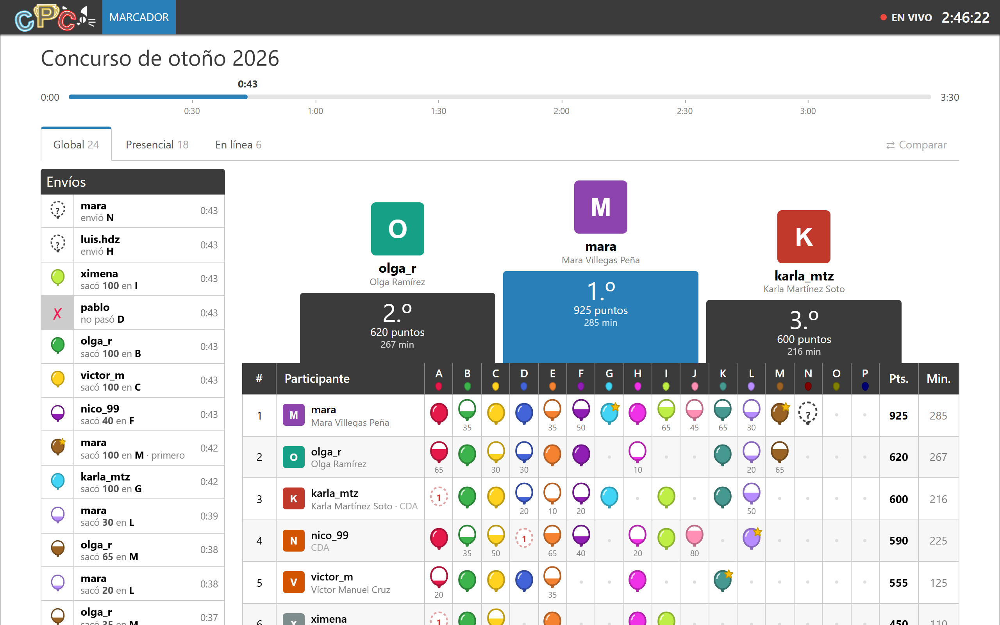</a>

Run individual or team contests, on site and online at once, with registration
before the start, a public live scoreboard, frozen standings, a reveal ceremony
and balloon delivery. Hold 1v1 duels and knockout tournaments on a projector, and
write to your users from the admin. This fork is maintained by **CPC-UAEH**, the
Club de Programación Competitiva UAEH, and runs at [cpcjudge.com](https://cpcjudge.com).
It builds on [DMOJ](https://github.com/DMOJ/online-judge), which provides
statements in Markdown and LaTeX, live results, several contest formats, virtual
participation and many languages through the
[judge server](https://github.com/DMOJ/judge-server).

*The screenshots use fictional demo accounts, teams and contests, and show the
Spanish interface; English is included too. Click a picture to see it full size,
or browse the [gallery](docs/screenshots/README.md).*

## Contests

<table>
<tr>
<td width="50%" valign="top">
<b>Public scoreboard</b> 
<a href="docs/screenshots/public-scoreboard-compare.png">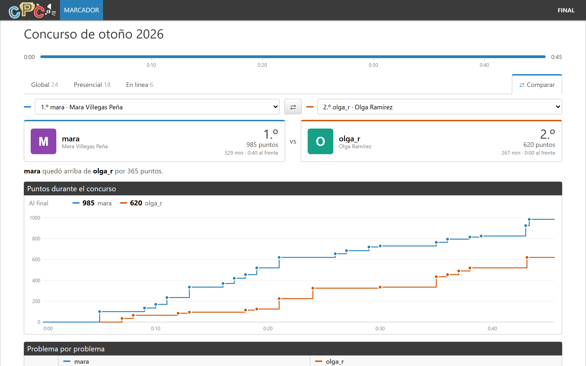</a> 
A live page for anybody, without an account: a podium, a balloon per problem
and the latest submissions, following the freeze. After the contest, Compare
charts how two contestants went up. Also for private and hidden contests.
</td>
<td width="50%" valign="top">
<b>Registration before the start</b> 
<a href="docs/screenshots/contest-list.png">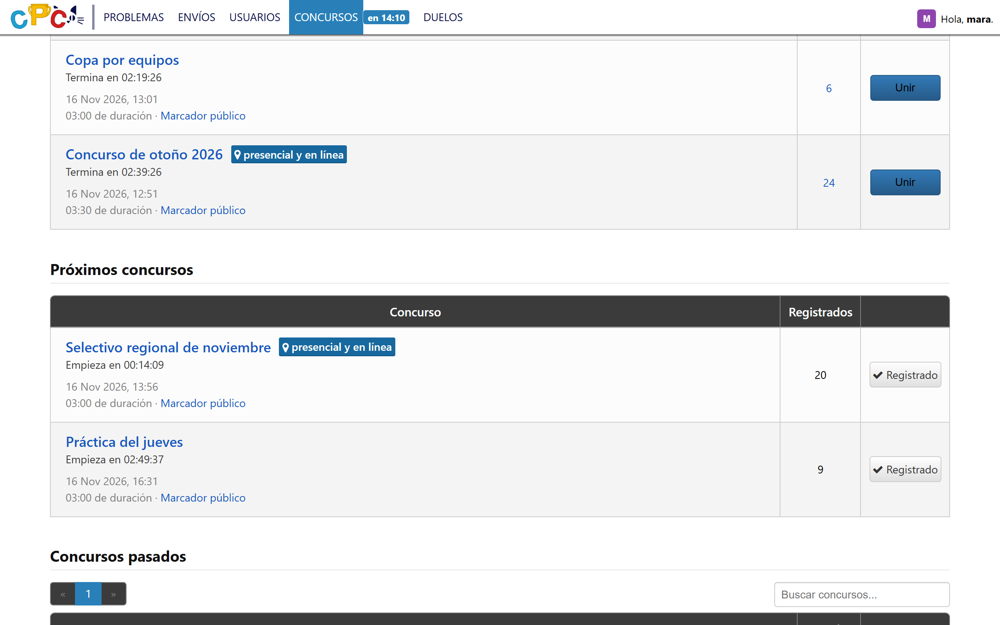</a> 
Register from the contest list or page; the access code is asked once. A pill in
the navigation bar counts down, then shows the time left, and at the start a
short prompt asks whether to enter.
</td>
</tr>
<tr>
<td width="50%" valign="top">
<b>On site and online</b> 
<a href="docs/screenshots/contest-registered.png">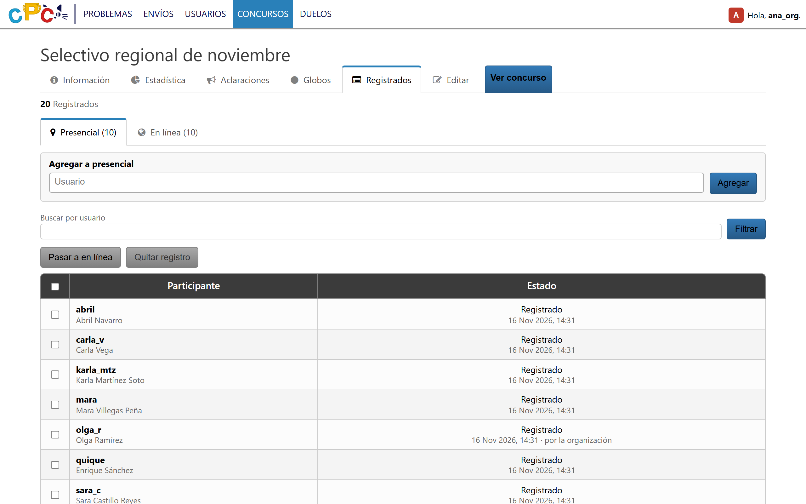</a> 
One contest with Global, On site and Online standings. Organizers register
people and teams from the Registered tab, mark who is on site and choose who
gets a rating.
</td>
<td width="50%" valign="top">
<b>Teams</b> 
<a href="docs/screenshots/teams-my-teams.png">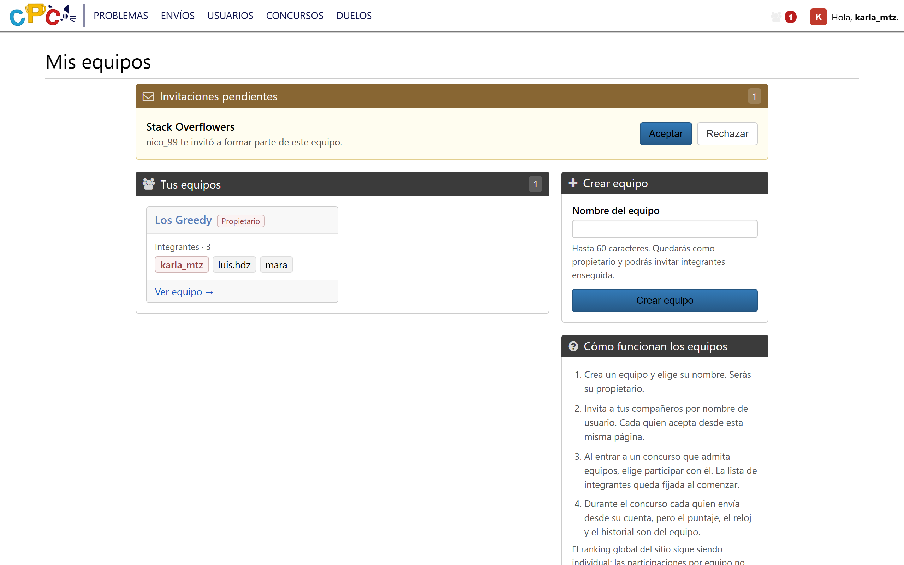</a> 
Teams with invitations, and individual, team or mixed contests with separate
rankings. Members submit from their own accounts and share the team's score and
clock.
</td>
</tr>
<tr>
<td width="50%" valign="top">
<b>Frozen scoreboards</b> 
<a href="docs/screenshots/scoreboard-freeze.png">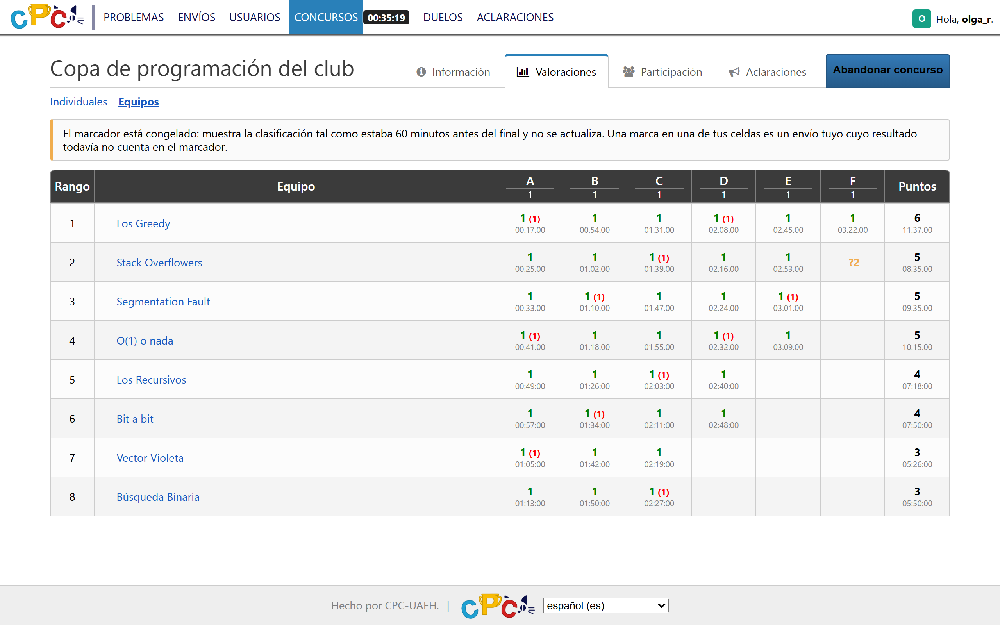</a> 
Results stay hidden everywhere during the freeze: standings, submissions,
statistics, the API and live updates. Organizers release them.
</td>
<td width="50%" valign="top">
<b>Announcements and clarifications</b> 
<a href="docs/screenshots/announcements.png">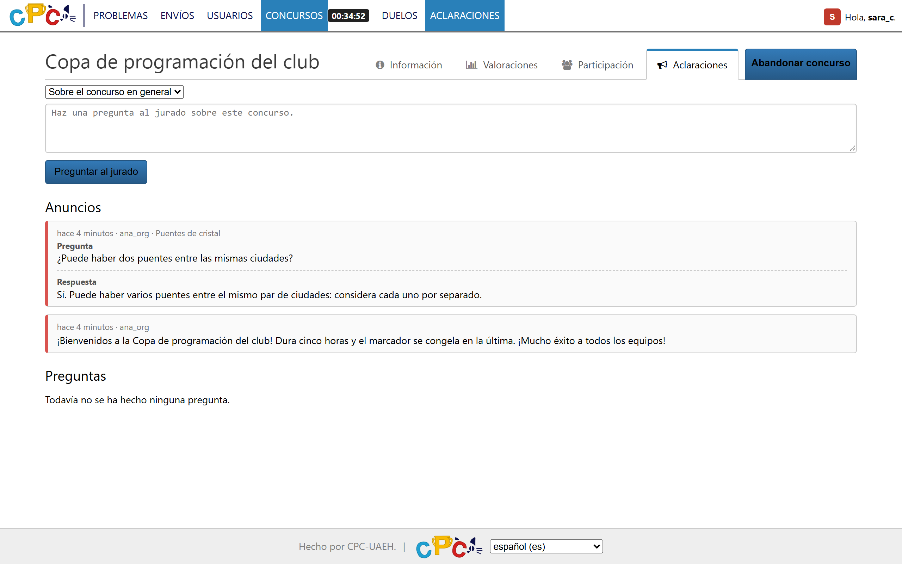</a> 
Announcements pop up inside the contest at once. Contestants ask about a
problem; the jury answers privately or for everyone.
</td>
</tr>
<tr>
<td width="50%" valign="top">
<b>Reveal ceremony</b> 
<a href="docs/screenshots/reveal-ceremony.png">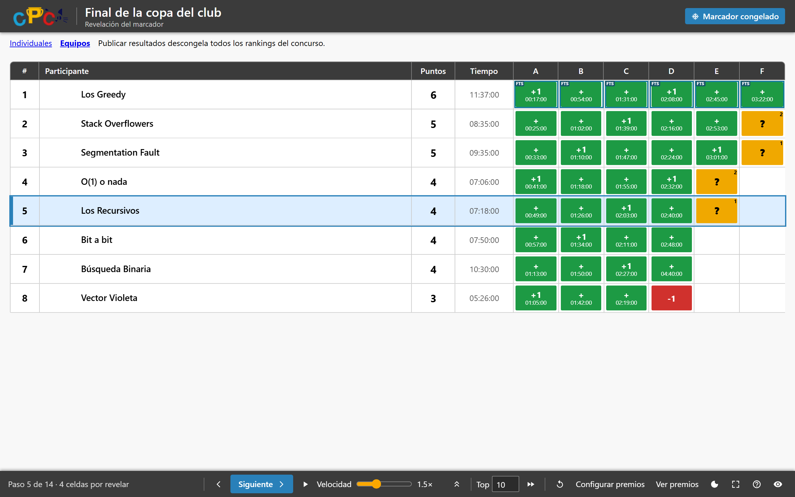</a> 
Reveal the final standings step by step, with medals, ties and first-to-solve
awards, for contestants or teams.
</td>
<td width="50%" valign="top">
<b>Balloon delivery</b> 
<a href="docs/screenshots/balloon-desk.png">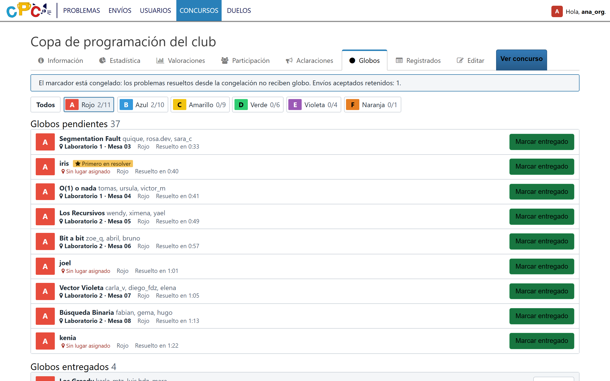</a> 
Pending and delivered balloons, problem colors, seat locations and undo, behind
their own staff permission.
</td>
</tr>
</table>

Also: every statement of a contest in one PDF ([pdfoid](docs/pdf.md)),
rankings that refresh themselves, and contest clones that keep their problems.
See the [contest guide](docs/contest-tools.md).

## Duels

First-to-solve battles between two players, alone or as best-of-N series, and
knockout tournaments of up to 64 places.

<table>
<tr>
<td width="50%" valign="top">
<b>Organizer panel</b> 
<a href="docs/screenshots/duels-panel.png">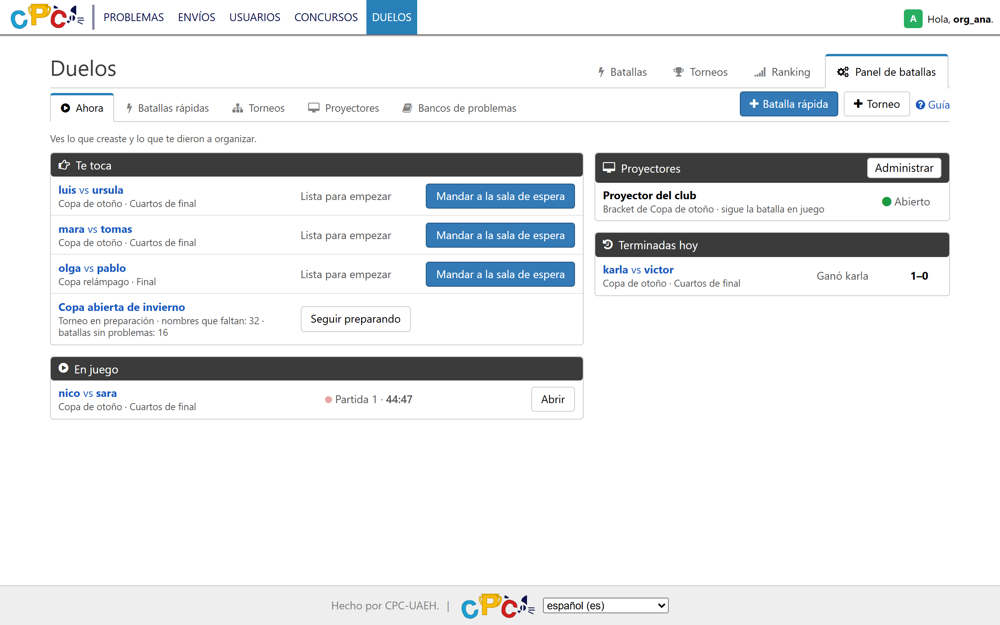</a> 
Every battle shows one button with its next step. Organizers call the players
and pick the problems by hand or from a problem bank.
</td>
<td width="50%" valign="top">
<b>Tournaments</b> 
<a href="docs/screenshots/duels-tournament.png">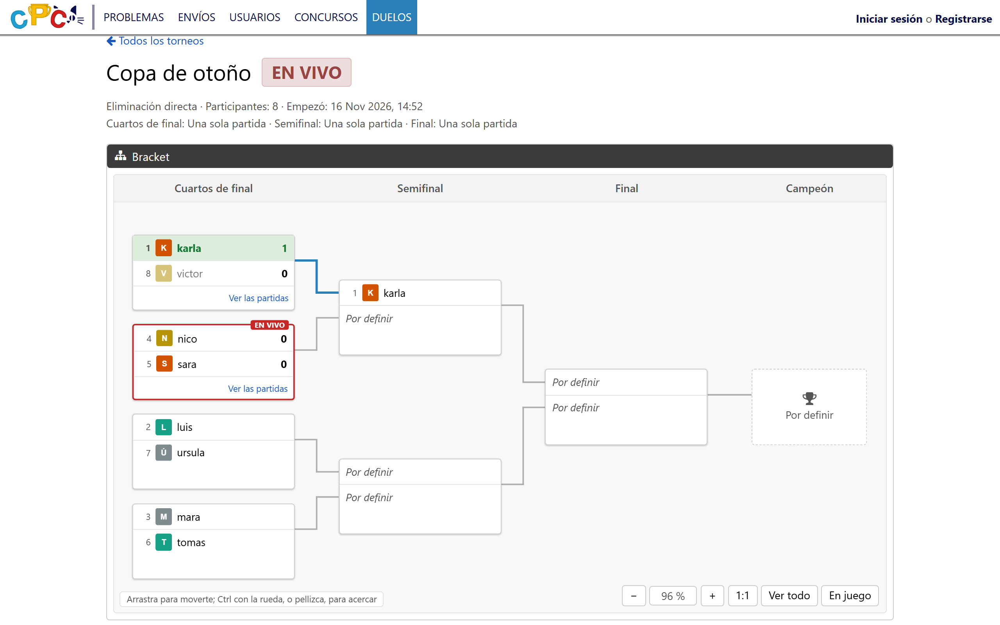</a> 
A bracket that builds itself, public pages that follow the games live, and a
Glicko-2 ranking of the battles that count.
</td>
</tr>
<tr>
<td width="50%" valign="top">
<b>Players</b> 
<a href="docs/screenshots/duels-player.png">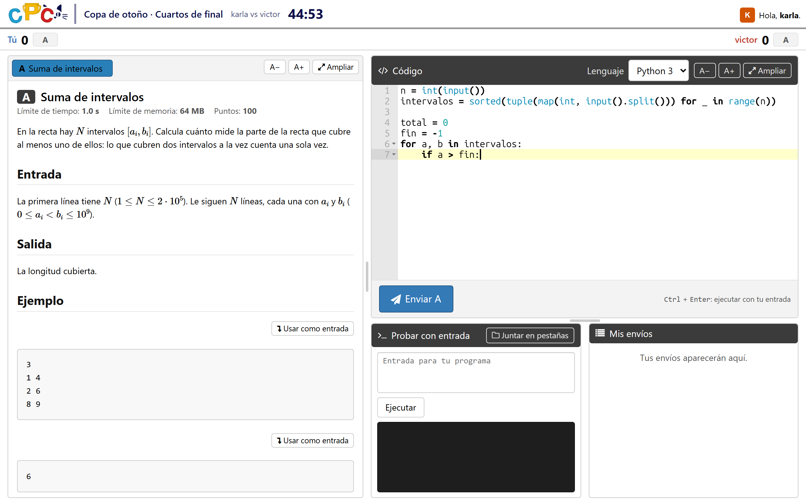</a> 
Players stay on the duel page and submit from it until the battle is decided.
A round can start with a C++ template already written.
</td>
<td width="50%" valign="top">
<b>Projectors</b> 
<a href="docs/screenshots/duels-projector.png">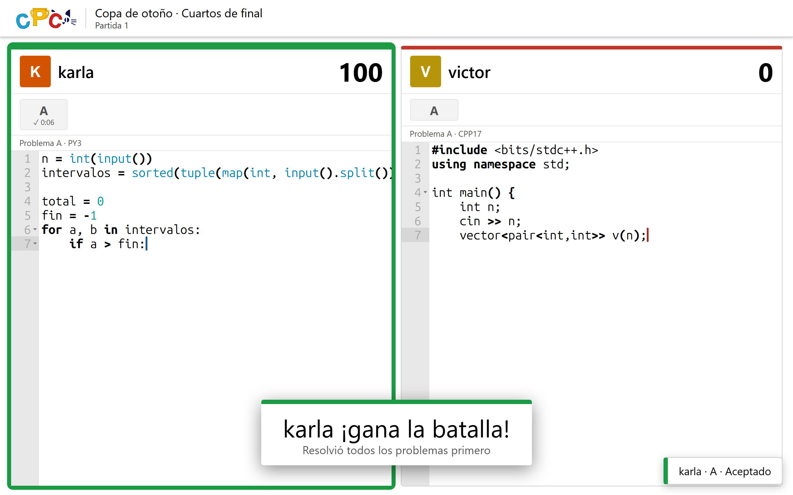</a> 
Paired with a code, a projector shows both players' code live, the scoreboard,
the statements and the bracket.
</td>
</tr>
</table>

See the [duels guide](docs/duels.md) for the setup, the rules of a game and who
organizes what.

## Problems and the editor

<table>
<tr>
<td width="50%" valign="top">
<b>Autocomplete</b> 
<a href="docs/screenshots/editor-autocomplete.png">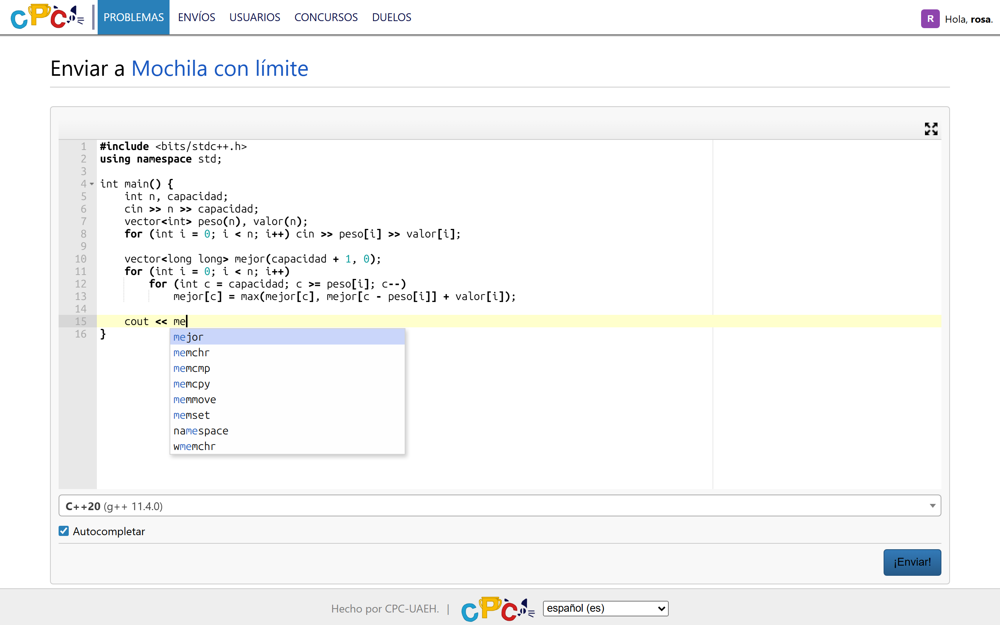</a> 
Submit, custom tests and duels suggest as you type, including whole
<code>#include</code> lines in C and C++. Each contest or duel round decides
whether it is allowed.
</td>
<td width="50%" valign="top">
<b>Interactive problems</b> 
<a href="docs/screenshots/interactive-problem.png">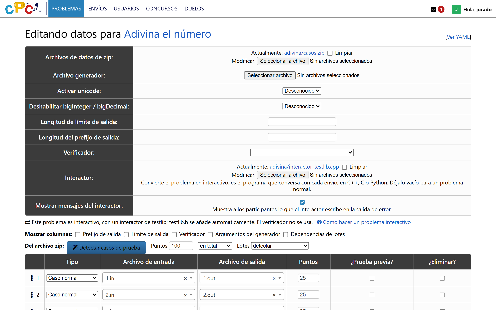</a> 
Upload an interactor next to the test data. Testlib is recognized and
<code>testlib.h</code> supplied, with a <a href="docs/interactive-problems.md">guide</a>
and a complete example.
</td>
</tr>
<tr>
<td width="50%" valign="top">
<b>Sample tables and math</b> 
<a href="docs/screenshots/sample-table.png">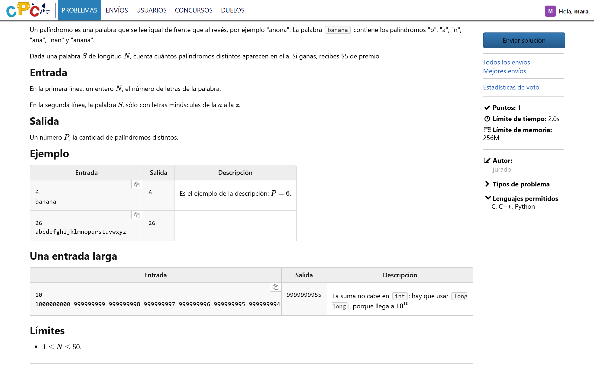</a> 
Samples written with <code>||input</code> and <code>||output</code> show as a
compact table with a copy icon, and inline formulas also accept
<code>$...$</code>. See <a href="docs/statements.md">the syntax</a>.
</td>
<td width="50%" valign="top">
<b>Test cases from ZIP archives</b> 
<a href="docs/screenshots/testcase-autofill.png">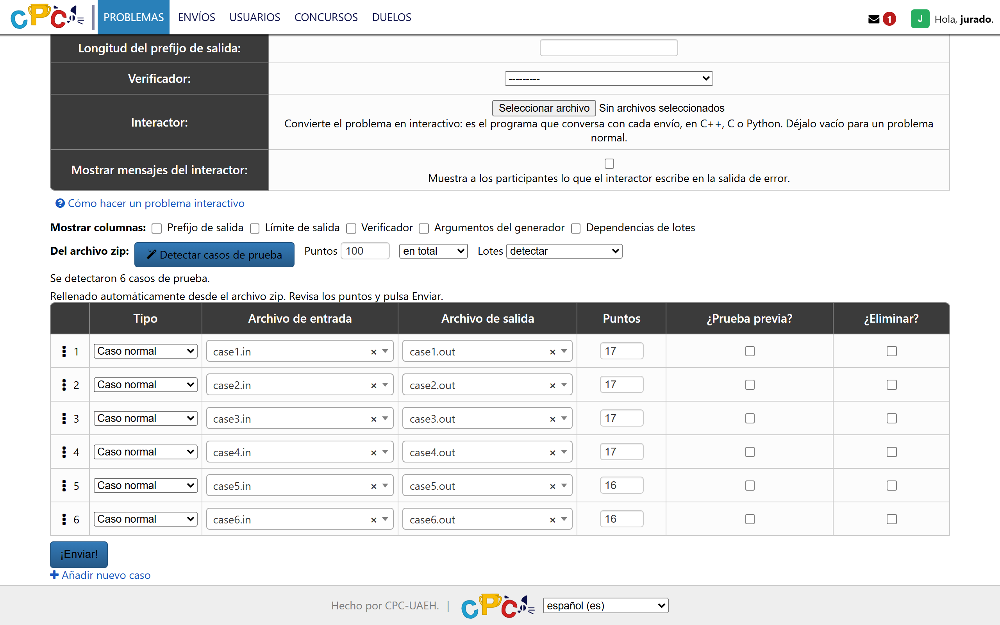</a> 
Input and output files pair themselves by extension or folder, in natural
order, with batches and points filled in.
</td>
</tr>
</table>

Also: a roomier [custom test](docs/screenshots/custom-test.png) editor with
output up to 64 KB, kept out of public histories and statistics.

## Administration and email

<table>
<tr>
<td width="50%" valign="top">
<b>Emails to users</b> 
<a href="docs/screenshots/mass-email-preview.png">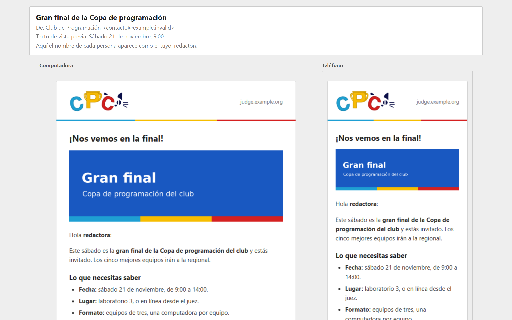</a> 
Write one email in the admin and send it through Resend to everyone, to filtered
audiences or to people chosen by name. Whoever writes asks for approval; an
approver reviews and sends. See <a href="docs/mass-email.md">Emails to users</a>.
</td>
<td width="50%" valign="top">
<b>Light and dark themes</b> 
<a href="docs/screenshots/dark-mode.png">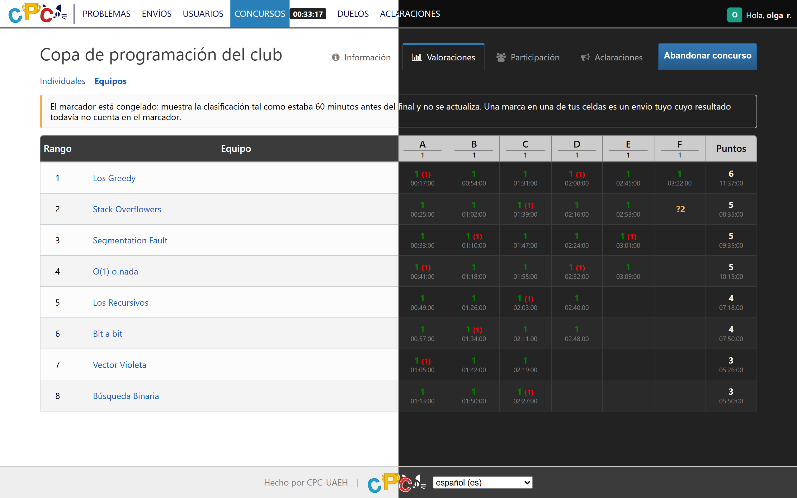</a> 
Every account chooses light, dark or the system's theme. Phones get a stable
480 px layout, and account emails share one design that reads well everywhere.
</td>
</tr>
<tr>
<td width="50%" valign="top">
<b>Teams in the admin</b> 
<a href="docs/screenshots/admin-teams.png">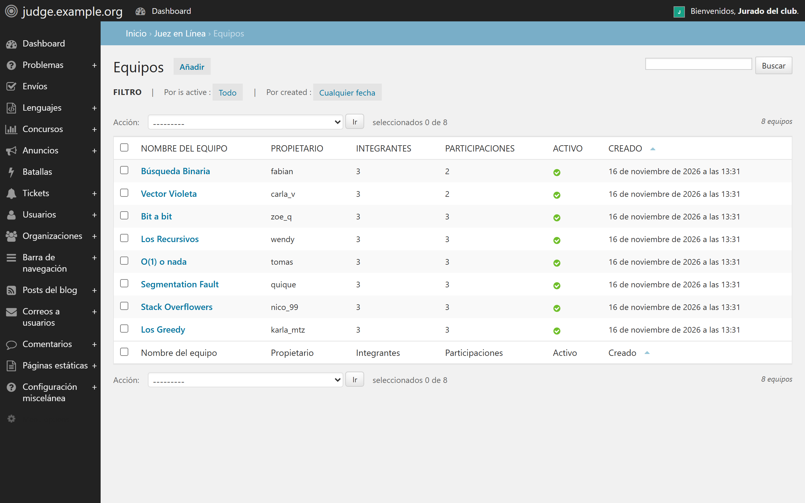</a> 
Teams, invitations and memberships, searchable by team or member, with their
contest participations.
</td>
<td width="50%" valign="top">
<b>Protected owner accounts</b> 
<a href="docs/screenshots/admin-owner-lock.png">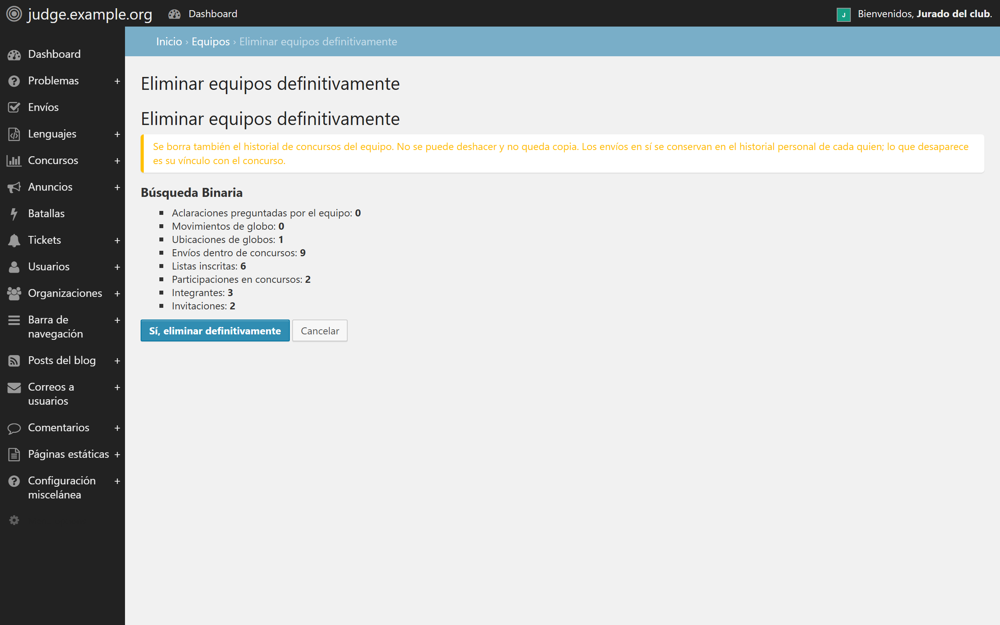</a> 
Accounts in <code>CPC_SERVER_OWNERS</code> control deletion, which lists what
goes before confirming; other superusers cannot edit them.
</td>
</tr>
</table>

## Security

Protections in the source include protected owner accounts, impersonation only
for superusers and logged, private custom tests with rate limits, jury tools
scoped to their contests, an upload check before large request bodies, email
limits and an event daemon that survives malformed messages. The
[deployment examples](deploy/examples/README.md) and
[security guides](docs/security/README.md) cover what each installation must
configure, and the known limitations.

All protections and deployment controls

### Application protections

- **Protected owner accounts:** owner-only deletion and sensitive account
  administration, including protection from changes by other superusers.
- **Restricted impersonation:** superuser-only access, protected superuser
  accounts and audit logging.
- **Private custom tests:** signed ownership checks, read-only result polling
  and exclusion from public histories, APIs and statistics.
- **Abuse controls:** configurable admission and rate checks for custom tests,
  plus rate and length limits for contestant clarification requests.
- **Controlled deletion:** explicit confirmations list the records affected by
  permanent team or contest deletion; submission records are preserved.
- **Scoped jury tools:** jury members can only file or move clarifications into
  contests they can edit, and answers change visibility together with their
  announcements.
- **Upload check:** Nginx asks the application whether a caller may upload
  problem data before accepting a large request body.
- **Live updates that stay up:** the event daemon answers malformed messages
  with an error instead of ending the process.
- **Email limits:** two password reset emails per address and one email change
  per account in 24 hours, a daily cap for the whole site with a reserve for
  existing accounts, and no account is created if its activation email cannot be
  sent.

### Deployment controls

The deployment examples and security guides provide configuration for:

- separate unprivileged service accounts, systemd isolation and read-only code;
- authenticated Redis and private service listeners;
- secure session and CSRF cookies, edge HSTS, a structural Content Security
  Policy and referrer policy;
- the visitor's real address behind a tunnel, so per-IP limits count each visitor;
- request-size limits, a permission check before large uploads, on-disk request
  buffering, disabled directory listings and a private event-publishing endpoint;
- protected configuration and backups, and scheduled cleanup of finished custom
  tests.

Application protections are included in the source; deployment controls must be
configured for each installation.

## Django 5.2

This fork runs on **Django 5.2.17**, pinned in [`requirements.txt`](requirements.txt),
with the tested django-mptt and django-compressor versions. It needs Python 3.10
or newer. The
[upgrade guide](docs/django52/README.md) covers the code changes, the settings
and how to upgrade an existing installation.

## Installation and documentation

Install it like DMOJ, cloning this repository instead of DMOJ's; do not install
DMOJ first and switch. [Setting up this fork](docs/setup-guide.md) lists the
differences, then covers settings, migrations, translations, static assets,
services, scheduled cleanup and your own branding.

| Guide | Contents |
| --- | --- |
| [Setup guide](docs/setup-guide.md) | Installation, configuration and verification |
| [Fork overview](docs/fork-overview.md) | Every change relative to upstream |
| [Django 5.2 upgrade](docs/django52/README.md) | Compatibility changes, tested dependencies and upgrade guidance |
| [Contest tools](docs/contest-tools.md) | Registration, on site and online, freeze, reveal, balloons, announcements, clarifications and the public scoreboard |
| [Interactive problems](docs/interactive-problems.md) | Interactors from the data page, judge requirements and verdicts |
| [Duels](docs/duels.md) | Battles, tournaments, projectors, who organizes what, settings and limitations |
| [Emails to users](docs/mass-email.md) | Announcements to many accounts through Resend: audiences, sending, unsubscribes, permissions |
| [Sample tables and math](docs/statements.md) | The `\|\|input` table and `$...$` in statements |
| [PDFs](docs/pdf.md) | Problem and contest PDFs with pdfoid |
| [Deployment examples](deploy/examples/README.md) | Example service units, Nginx settings and maintenance tasks |
| [Security guides](docs/security/README.md) | How to configure each control, and known limitations |
| [Screenshot gallery](docs/screenshots/README.md) | Every demonstration image, full size |

## Upstream and license

Based on DMOJ commit `97f3722ef3f7ca9731727c220622bdd1eab7d4b3`.
Distributed under the [GNU Affero General Public License v3](LICENSE).
See [MODIFICATIONS.md](MODIFICATIONS.md) for the fork's changes and attribution.

Production credentials, user data, problem packages, uploaded media, logs and
generated static files are excluded from this repository.

Upstream resources: [DMOJ](https://github.com/DMOJ/online-judge) ·
[Documentation](https://docs.dmoj.ca/) ·
[Judge server](https://github.com/DMOJ/judge-server) ·
[Community](https://dmoj.ca/about/discord/).
