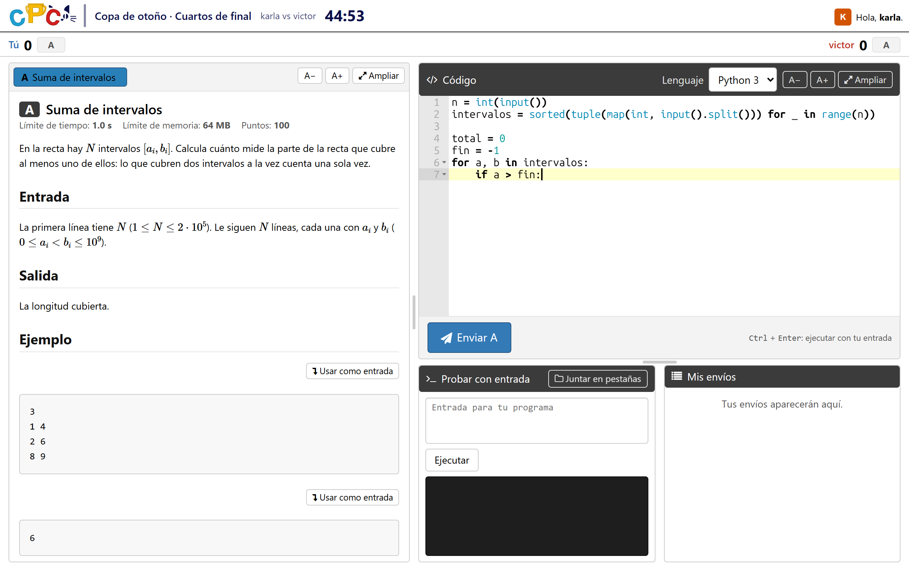
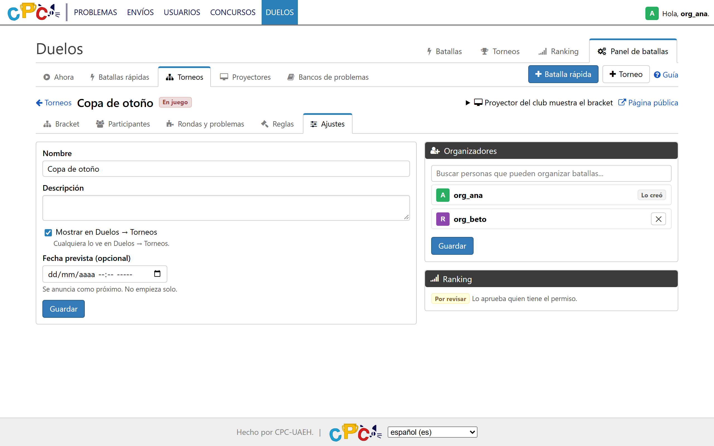
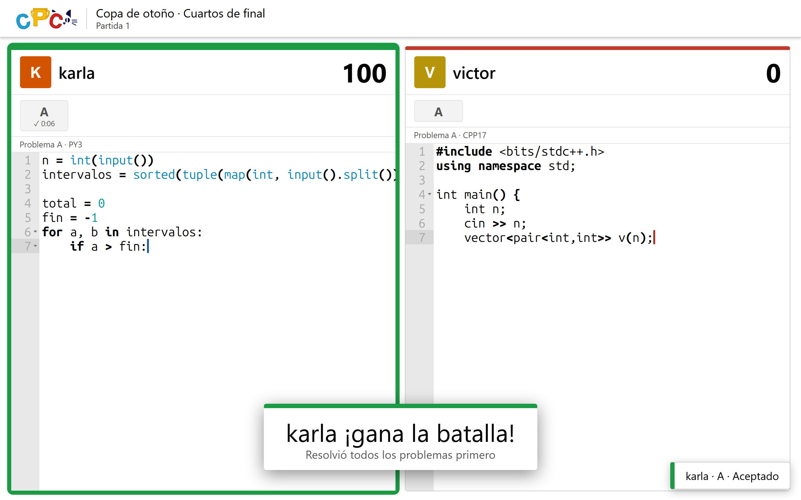

# Duels and tournaments

Duels are first-to-solve battles between two players. A battle is one game or a
best-of-N series, and a tournament arranges battles in a knockout bracket.
Tournaments have a public history, and approved battles feed a Glicko-2 ranking.
The site shows them at `/duelos/`; in the code the feature is called *arena*
(`judge/arena`, the `Arena*` models and the `arena_*` URL names). Requests to the
earlier address `/arena/…` are forwarded to the same place under `/duelos/` with a
307, so saved projector links and open player pages keep working.

## Setting it up

1. **Migrate.** The duel migrations are `0157_arena` (the `judge_arena*` tables),
   `0159_own_permissions` (co-organizers), `0160_duel_history`,
   `0161_duel_ranking`, `0163_duel_panel` and `0166_arena_tournament_cancelled`.
   The ones in between belong to other features.
2. **Use a shared cache.** Live code, drafts, the player lock, projector codes and
   the request limits live in the Django cache. With several web workers it must be
   shared (Redis, as in the [settings example](../dmoj/local_settings.example.py));
   a per-process cache makes players and screens see different things.
3. **Give organizers a permission.** `judge | arena match | Organize own arena
   battles` (`judge.manage_arena`) lets a person organize their own battles;
   `Organize all arena battles` (`judge.manage_all_arena`) gives every battle of
   every organizer. See [Who organizes what](#who-organizes-what). Create a group
   with one of them, plus `see_private_problem` if battles should use problems that
   are not public, and add the organizers. Superusers have every duel permission.
4. **Add the navigation entry.** In the admin, under *Navigation bar*, add an
   entry with key `arena`, label `Duelos`, path `/duelos/` and regex `^/duelos`.
   It is translated through the `dmoj-user` catalog, which has `Duelos` in both
   languages; a label with no entry in the reader's language falls back to English.
5. **Recompile translations and, with offline compression, regenerate the
   manifest**, as after any template change. See the
   [setup guide](setup-guide.md#4-translations).

The judges need the problems used in battles, as for any contest. The admin gets
a *Battles* section (`dmoj/settings.py`, `WPADMIN`): if your private settings
redefine `WPADMIN`, copy that entry into yours.

## Running battles

Organizers work from *Battle panel* (`/duelos/manage/`), with the tabs *Now*,
*Quick battles*, *Tournaments*, *Projectors* and *Problem banks*; battles and
tournaments are listed 20 per page. *Now* shows under *Your turn* what waits for
the organizer, with the button for the next step. The organizer guide, in Spanish,
is at `/duelos/manage/guide/`.

- **Quick battle.** Pick two players and the problems of the first game (up to
  five per game); the other games can get theirs later. *Create and send to the
  waiting room* sends both players to the duel page. *Start game 1* begins a
  countdown, and then the statements appear. Series go up to best of 9.
- **A battle's page** has one main button, for the next step, and the tabs *Live*,
  *Problems*, *Settings* and *Log*. Voiding a game, giving a game or the battle to
  a player and cancelling are folded under *Something went wrong?*.
- **Tournament.** Created with its participants, or with only a number of places
  (2 to 64) to be named later. Seeding is by hand, at random, by contest rating or
  by duel rating, with an optional third-place match. The bracket is rebuilt by
  itself when participants, places or the third-place option change; chosen
  problems stay with their place, counting rounds from the final, and the page
  warns before a change drops some. Rounds are named from the Final back to the
  Round of 64; each sets its games per battle (fixed once it starts), problems per
  game, difficulty, C++ template and autocomplete.
- **Problems.** Choose them by hand for each battle and each game, even before the
  players are known, or let a *problem bank* deal them: on call, on start and after
  each game, never repeating a problem inside the tournament, optionally limited
  to a range of difficulties per round. What was chosen by hand is never replaced.
  If the bank runs out, the game is left for the organizer to fill in.
- **Cancelling a tournament** (*Something went wrong?*) cancels its undecided
  battles and releases their players; what was decided stays. It moves to
  *Archived*, leaves the public history (it can be shown again, with no podium)
  and never counts for the ranking; one that already counts can only be cancelled
  by whoever decides the ranking.
- **Several organizers** can work at once. Every action carries a version; an
  action based on an old state is refused instead of overwriting someone else's.

### Who organizes what

| Permission | Gives |
| --- | --- |
| `judge.manage_arena`, "Organize own arena battles" | The quick battles and tournaments the person created or was added to as a co-organizer, with all their games, plus their own projectors and problem banks |
| `judge.manage_all_arena`, "Organize all arena battles" | Everything, from every organizer; works on its own |
| `judge.hide_arena_history`, "Show or hide any tournament in the history of the duels" | Only that, from the tournament's public page. Organizers already do it for theirs, and `manage_all_arena` for all |
| `judge.decide_arena_ranking`, "Decide which tournaments and duels count for the ranking of the duels" | Only [what counts](#history-and-ranking). Neither organizing permission includes it |

- The *Settings* of each tournament and quick battle have an **Organizers** panel
  to add or remove co-organizers, who need an organizing permission. A tournament's
  battles are managed by its organizers.
- Each organizer has their own **projectors**: the first is created with their
  first battle or tournament, and a new battle never takes someone else's free
  projector. **Problem banks** belong to whoever created them; a tournament that
  already uses someone else's bank keeps it.
- What belongs to someone else answers 404, and the *Battles* lists of the admin
  show only one's own objects. Problems a person cannot see (private ones without
  `see_private_problem`) are not shown in banks and are kept when a bank is saved.
- **Whoever plays does not organize.** Nobody puts themselves in a battle or a
  tournament they organize. A battle is closed to its players until it is decided,
  and a tournament, with its battles, bank and projectors, to those still in it.

### Rules of a game

Rules come from the tournament (*Rules*), the round (only the C++ template and
autocomplete) and the battle (*Settings*), each overriding the previous one. A battle stores only
what its own settings change, and a game keeps the rules it started with.

| Rule | Default | Range |
| --- | --- | --- |
| Duration | 15 minutes | 1 to 300 |
| Countdown | 10 seconds | 3 to 60 |
| Partial points | off: all or nothing | |
| Penalty per failed attempt | 0 minutes | 0 to 60 |
| Maximum attempts per problem | unlimited | 0 to 50 |
| Languages | every language the problem allows | |
| Block pasting | on | |
| Show rival progress | on (points and attempts, never code) | |
| Code on the screens | on | |
| Start with the C++ template | off | |
| Autocomplete code | off | |

The player with more points wins; on equal points, whoever got there first, with
the penalty added for each failed attempt before their best submission. Compile
and internal errors cost nothing. A game ends by itself as soon as nobody can
change the result, and waits for a pending submission only while it could. A tie
at the end is decided by the organizer or by a tiebreak game.

With the **C++ template**, each problem opens in C++ (the player's own C++, else
the newest one allowed) with a fixed `main()` and the cursor inside it; changing
language before typing removes it. A tournament sets it per round, in the
*Template* column of *Rounds and problems*; a quick battle, under *More rules*.

**Autocomplete code** is set for the whole tournament in *Rules*; a round can
follow it or say yes or no, and a quick battle sets it under *More rules*.
Players can still turn it off in their editor.

### Club laptops

For quick battles on shared machines, sign in with a trusted account without
permissions and type the name to show for each player. When the battle ends,
drafts and review data are cleared for the next person. Players with their own
account can stay to review the game afterwards: the editor and custom input keep
working and each submission shows its code.

## History and ranking

`/duelos/torneos/` lists the tournaments being played, upcoming and finished. It
and `/duelos/ranking/` are open without an account, and `/duelos/` leads there
without one. A tournament's page has the podium, the bracket, each battle and game
with its winner and how it ended, and the final standings, and updates itself.

A tournament appears once it starts, unless its organizers uncheck *Show in Duels →
Tournaments* in its *Settings* (for a test). *Planned date (optional)* announces a
draft as upcoming, with only its name, date and description; it starts nothing.
Code, submissions, projector links and the problems of games not played yet are
never public; problem names appear once the tournament is over, and only to those
who may open them.

Ratings use Glicko-2, from 1500 ± 350 with volatility 0.06 and τ 0.5. Each battle
is one rating period, and each game that counts is one result against the rival's
rating before the battle; the deviation grows for every whole week without one. A
number shows after 3 games that count, and a player moves to *Inactive* after 365
days without one. The contest rating is not touched, and no rating is set by hand.

Everything starts *To review* and counts only once somebody with the permission to
decide approves it: in *Approve results* (`/duelos/ranking/decidir/`), with the
admin's list actions or, for a quick battle, when creating it. A tournament is
decided as a whole, and one of its battles can be taken out. In a battle that
counts, every finished game with a winner counts, in the order played. These never
count: ties, voided games, cancelled battles, battles of a cancelled tournament,
byes, walkovers and club-laptop battles with a typed name. An unlisted account
only leaves the table.

## What players get

- *Battles*, the first tab of Duels, is where a signed-in player waits to be called.
- While their battle lasts, players are kept on the duel page: other pages send
  them back, and the normal submission page refuses submissions. The lock ends
  when the battle is decided or cancelled, and also after
  `CPC_ARENA_LOCK_IDLE_MINUTES` (60) without activity, so a battle left open by
  mistake does not hold anyone. It applies to staff too.
- The page keeps the site's navigation bar; during a battle the bar shows the
  battle, the players and the clock instead of the tabs.
- The statement, an editor, custom input with "Use as input" on every sample, and
  their submissions. Text size, enlarged panes, dividers and tabbed or side-by-side
  panels are remembered in the browser.
- Pasting is limited to text the player already has in this game's code or copied
  from the editor; pasting from elsewhere and dragging are blocked and flagged.
- The result is explained from each side, with the rival's name, every game of a
  series and the change in the player's rating, or why there is none.

## Projectors

A projector is a secret link that needs no account. To connect one, open
`/proyector` on its computer and type the 6-character code it shows in *Projectors*
→ *Connect a projector*; only that page gets the link, and the code lasts 10
minutes. *Change the link* closes every tab that uses the old one. The six views
are *Everything*, *Scoreboard*, *Code A*, *Code B*, *Statements* and *Bracket*; the
panel chooses what a projector shows and how. The keys 1 to 6 change the view too
(the last change wins), and a tab opened with `?view=` keeps its own.

A new quick battle and a tournament that starts take the organizer's first free
projector: one waiting, or one unchanged for 30 minutes since what it shows ended.
A message stays. A projector on a tournament follows the game being played; it
stays on that battle between games and for 30 seconds once it is decided.

Live code is sent by the editor about three times a second, kept in the cache and
polled by the screens. It does not go through the event daemon.

## Settings

All optional, in `local_settings.py`. Zero turns a request limit off; an invalid
or out-of-range value uses the default.

| Setting | Default | What it sets |
| --- | --- | --- |
| `CPC_ARENA_LOCK_IDLE_MINUTES` | 60 | Minutes without activity before the lock lets players go (5 to 1440) |
| `CPC_ARENA_STATE_PER_SECOND` | 6 | State polls per player |
| `CPC_ARENA_CODE_PER_SECOND` | 4 | Live code updates per player; the editor sends at most 3 |
| `CPC_ARENA_SUBMISSIONS_PER_10_SECONDS` | 4 | Submissions per player |
| `CPC_ARENA_SCREEN_PER_SECOND` | 30 | Requests per projector screen |
| `CPC_ARENA_PAIR_PER_MINUTE` | 10 | New `/proyector` codes per client address |
| `CPC_ARENA_PAIR_STATE_PER_SECOND` | 3 | Polls per projector code |
| `CPC_ARENA_PROVISIONAL_GAMES` | 3 | Games that count before a rating shows (1 to 100) |
| `CPC_ARENA_INACTIVE_DAYS` | 365 | Days without a game that counts before a player is inactive (30 to 3650) |

Request bodies are capped at 200 KB and code at 64 KB.

## How it works

- Each game is backed by a hidden, unrated contest created when the game starts,
  with key `arena<n>…` and a hidden scoreboard. Judging goes through the normal
  contest queue, the bridge and `update_contest`. The contest does not set the
  players' current contest.
- These contests are left out of `/contests/` and out of the contest and
  participation lists of the admin. The *Battles* section has a *Duel contests*
  entry that lists them (`?duelos=si`). Deleting a game deletes its contest; a game
  in progress cannot be deleted.
- The engine is lazy: each state poll decides start, end and winner, and only locks
  the match row when something changes. There is no periodic task. Public pages
  never move a game forward, and their live answer is cached for a few seconds.
- The ranking is worked out again in full after anything that can move a rating,
  one process at a time (a named MariaDB lock). A failure is logged and never
  undoes the battle; `manage.py rate_duels` checks it, and `--recompute` redoes it.
- Every organizer action and ranking decision is recorded in `ArenaAction`.

## Known limitations

- Keeping players on the editor is only partly possible. The site blocks
  submitting elsewhere, the rest of the site, pasting and dragging, and flags
  suspicious signals, but nothing stops someone from typing what they see on
  another device.
- With public problems, battle submissions show up in the submission lists and the
  API like those of any hidden contest.
- A screen link gives read-only access to whatever that screen shows, live code
  included. Keep it private and change it after an event.
- An account that played a battle cannot be deleted; deactivate it instead.
- Verdicts reach the page by polling, within about a second.
- Cancelling a tournament cannot be undone; with only the third-place match left,
  it leaves no champion (give that match by walkover). A superuser can change the
  status in the admin, which releases nobody. An open public page of a cancelled
  tournament says LIVE until reloaded.
- The waiting room does not say that a game starts with the C++ template.

Tests: [`tests/duels`](../tests/duels/README.md).
