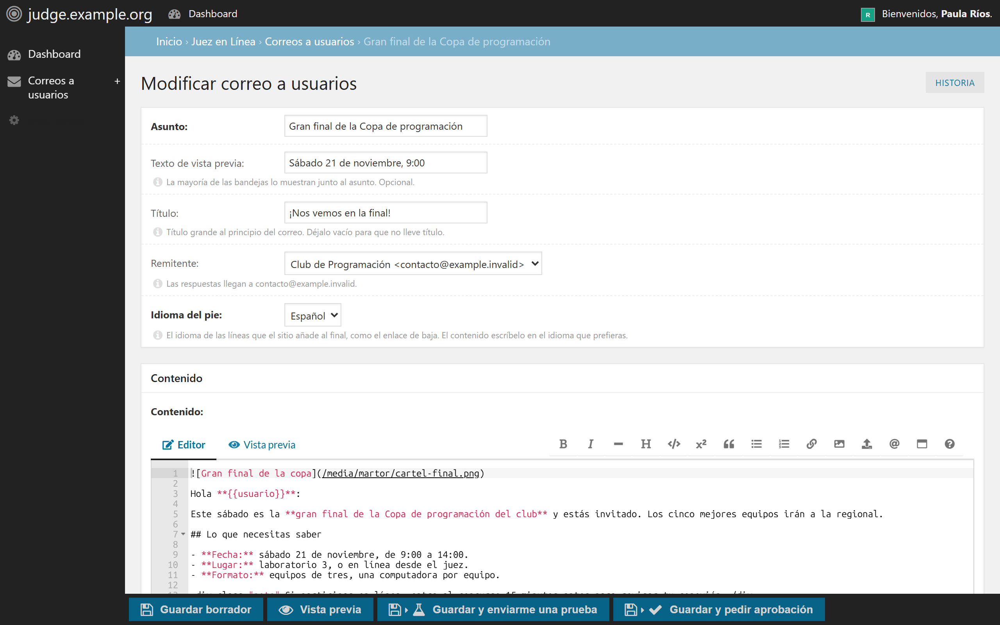
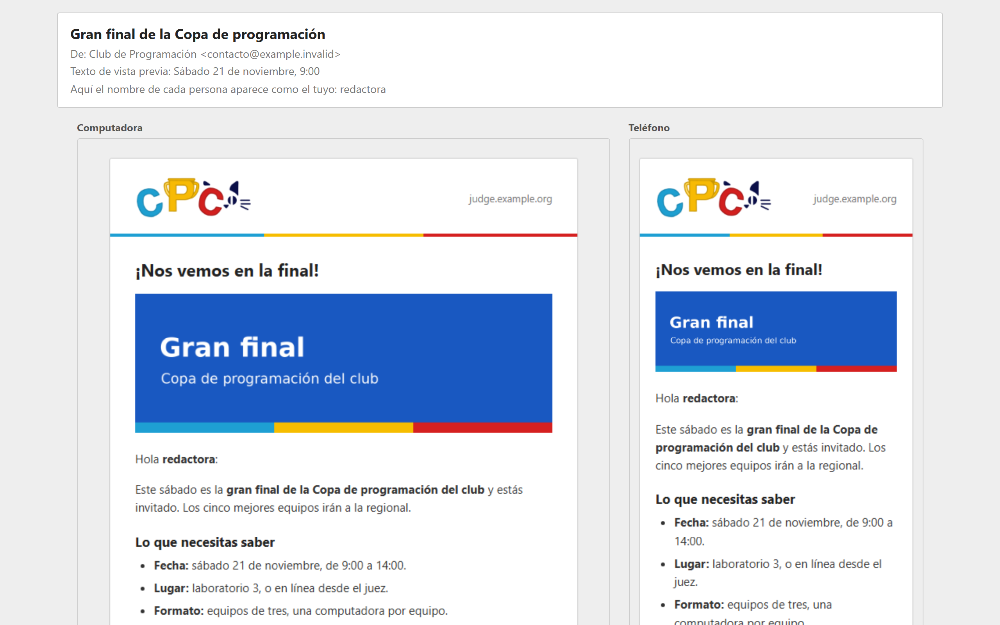
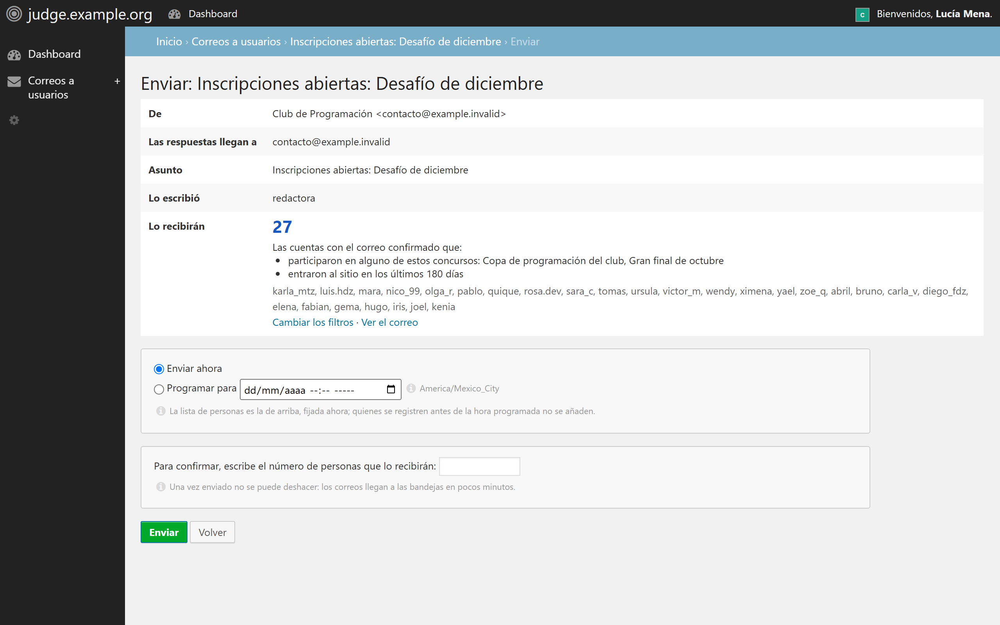
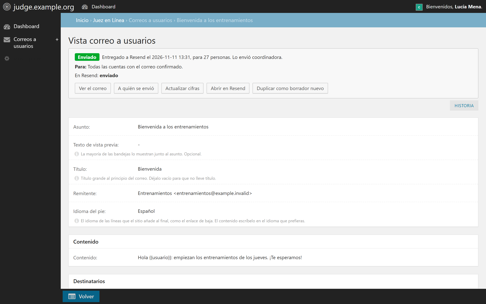

# Emails to users

Write one email in the admin and send it to many accounts at once: contest
announcements, training sessions, changes to the site. Whoever writes an email
asks for approval, and an approver sends it. These emails go through
[Resend](https://resend.com) Broadcasts, never through the site's SMTP:
transactional providers forbid bulk mail, and it would use up
`DMOJ_EMAIL_DAILY_LIMIT`, which protects account emails (see [Email](security/email.md)).



## Setting it up

1. Create a Resend account and verify your sending domain there (SPF and DKIM
   records in your DNS).
2. Create an API key with **full access**. A "sending only" key cannot create
   contacts or segments, and nothing could be sent.
3. Put the key in the secrets file as `DMOJ_RESEND_API_KEY` (see the
   [setup guide](setup-guide.md#2-private-settings)), and in
   `dmoj/local_settings.py`:

   ```python
   # Optional: first sender and reply-to. By default DEFAULT_FROM_EMAIL and SITE_ADMIN_EMAIL.
   DMOJ_MASS_EMAIL_FROM = 'Your Club <news@example.org>'
   DMOJ_MASS_EMAIL_REPLY_TO = 'contact@example.org'
   # Optional: base of links and images. By default https:// and the domain of the current Site.
   DMOJ_MASS_EMAIL_SITE_URL = 'https://judge.example.org'
   ```

   The sender's domain must be the one verified in Resend. Every other sender
   must be of that domain too.
4. Apply migrations `0158`, `0159` and `0165`, and restart the web service **and
   Celery**: a Celery task hands each email to Resend.
5. Give the permissions to whoever writes emails and to whoever approves them,
   for example with two groups (see [Permissions](#permissions)). Writing alone
   does not send. The section appears in the admin menu as Emails to users, with
   **Por aprobar** (Waiting for approval), the list of unsubscribed people and
   **Remitentes y redes** (Senders and networks) under it. On an installation
   that sent emails before migration `0165`, give `approve_mass_email` to whoever
   sent them: `send_mass_email` now only asks for approval.
6. In **Remitentes y redes**, save your senders and the links of your social
   networks (see [Senders and networks](#senders-and-networks)).

Without a key the section is there but cannot send, and "Save and send me a
test" stays disabled.

## Writing an email

- **Subject, preview text and title.** The preview text is what most inboxes
  show next to the subject. Leave the title empty for an email without one.
- **Remitente** (Sender): one of the list in Remitentes y redes, the first one
  unless you choose another. Replies go to the reply-to address whichever you
  choose. If a sender is taken off the list, an email that used it must choose
  another before it can be sent.
- **Content** in Markdown, with HTML allowed: it is cleaned with the `email`
  Markdown style, which drops what email programs cannot show (style sheets,
  audio, video) and math, which needs MathJax. Images come from the editor's
  uploader; links and images become absolute addresses. "How to give it format",
  under the editor, lists the boxes and buttons that look good in email programs.
- `{{usuario}}` (or `{{username}}`) becomes each person's username. Pasted
  addresses have no username and get it empty; the form warns about it.
- **Footer language:** the language of the lines the site adds at the end
  (unsubscribe link, contact). Write the content in whatever language you want.
- **Preview** shows the email as a desktop and a phone would, plus the plain text
  version. **Save and send me a test** sends one copy to your own address, marked
  `[Test]`, from the chosen sender.



## Who receives it

Only accounts with a confirmed email can receive these emails. Choose one of:

1. **Every account with a confirmed email.**
2. **Only those matching the filters.** Each filter narrows the list; within a
   filter with several choices one is enough:
   - took part in some contests (team members included; spectators do not count),
     optionally counting virtual participations;
   - member of some organizations, or of some permission groups;
   - visited the site in the last N days;
   - signed up on or after, and on or before, a date;
   - solved at least N problems;
   - rating at least / at most (accounts without a rating are left out of the
     minimum and count as below any maximum).

   "Also always these people" adds people the filters leave out.
3. **Only the people I choose,** by name.

"Never include" applies to the three and always wins. The form keeps a live
count with a sample of names, and describes the audience in words.

**Más correos** (More addresses) adds addresses without an account to any of the
three. Paste the column of addresses of a form, or whole rows of a spreadsheet:
text without an `@` is ignored. Each address becomes a chip. Badly written ones
show in red and the email cannot be saved with them; repeated ones are merged; a
domain that is a common typo, such as `gmial.com`, is marked with the likely one.
Up to 1,000 fit.

A pasted address goes as it is, without a name, also when it belongs to an
account, even one that never confirmed its email or was deactivated: the person
gave it in the form. When the email is sent, a pasted address already on the list
gets one email, and one of an account in "Never include" is left out. Whoever
only writes does not learn whose an address is: their count adds every pasted
address, and after sending they see neither the state of pasted addresses nor the
delivery figures.

## Approval

When an email is ready, its author presses **Guardar y pedir aprobación** (Save
and ask for approval). The email is now **Por aprobar** (Waiting for approval).
While it waits, only approvers can change it; its author can **Retirar la
solicitud** (Take back the request), and it is a draft again.

Approvers see every email. On one waiting for approval they can:

- open the send page with **Revisar y enviar** (Review and send);
- change it and **Guardar cambios** (Save changes). The email and the send page
  name who changed it under **Lo cambió al revisarlo:** (Changed while reviewing
  it:), and each change stays in its history;
- write a note under **Devolverlo con una nota** (Send it back with a note) and
  press **Devolver** (Send back). It is a draft again, and its author reads the
  note under **Lo devolvió quien aprueba:** (Sent back by the approver:).

Approvers send their own emails without asking: their bar shows **Save and go to
send** instead. Retrying a failed email and cancelling a scheduled one are also
for approvers.

What goes out is what was reviewed. If the email changed, was taken back or was
sent back while the send page was open, sending is refused and the page asks to
review it again. Saving warns if someone else saved the email after you opened
it; saving again replaces their changes.

Approvers see an envelope with the number of emails waiting in the site's
navigation bar, and an entry with that number in the menu under their name.
**Por aprobar** in the admin menu lists them. No email is sent about it.

## Sending

Only approvers reach the send page. It shows the sender, the reply-to address,
the subject and the audience, and, for an email waiting for approval, who wrote it
and who changed it. It asks you to **type the number of recipients** to confirm.
Send now or schedule it from 5 minutes to 30 days ahead. The list is fixed when
you confirm: people who sign up before a scheduled time are not added. People who
unsubscribed earlier are left out and counted apart.

Each address Resend does not have yet becomes a new contact there, pasted ones
included. If the email would take the account past `DMOJ_RESEND_CONTACT_LIMIT`
contacts, the page says how many more it needs and does not send: remove pasted
addresses, or delete old contacts in Resend.



Once confirmed, a task page follows the hand-over to Resend; you can leave it,
the task keeps running. If it fails after creating the list but before Resend
accepted the email, **Retry** continues without sending twice.

## After sending

A sent email can no longer be edited. Its page shows the status, who sent it,
delivery figures read from Resend (delivered, bounced, marked as spam,
unsubscribed, suppressed), who it was sent to, a link to open it in Resend, and
**Duplicate as a new draft**. The bar at the bottom of a page you can only view
offers **Back**.



## Senders and networks

**Remitentes y redes** (Senders and networks), under Emails to users in the
admin, holds:

- **Remitentes** (Senders): the addresses the form offers, one per line, as
  `Name <address>` or the address alone, all of the domain of
  `DMOJ_MASS_EMAIL_FROM`. The first one is the default. Until a list is saved it
  holds that sender and four more of the same domain, named after this club
  (`DEFAULT_SENDERS` in `judge/mass_email.py`): save your own list before the
  first email.
- **Redes sociales** (Social networks): links to Facebook, Instagram, TikTok, X,
  YouTube, Discord, WhatsApp, LinkedIn and GitHub. Those with a link show with
  their grey icon at the foot of every email; empty ones do not.

Everybody with the section sees the page; approvers change it. Replies to any
sender go to the reply-to address. If people may write to the other senders
directly, make them aliases of a mailbox someone reads.

## Unsubscribes

Resend adds an unsubscribe link to every email and honours it, for pasted
addresses too. People who used it no longer receive emails to users, but still
get the emails of their account (activation, password reset, email change).
Unsubscribed people, under Emails to users in the admin, lists them with their
username; addresses are masked for anyone who is not a superuser. Subscribe
someone again only if they ask you to.

## Permissions

| Permission | Gives |
| --- | --- |
| `judge.send_mass_email`, "Escribir correos a usuarios propios y pedir su aprobación" (Write own emails to users and ask for approval) | The section, with only the emails the person wrote or duplicated: writing, testing and asking for approval |
| `judge.edit_all_mass_email`, "Editar todos los correos a usuarios" (Edit all emails to users) | All emails: everyone's drafts, and subscribing someone again; works on its own; does not send |
| `judge.approve_mass_email`, "Aprobar y enviar correos a usuarios" (Approve and send emails to users) | All emails: changing, sending or sending back those waiting for approval, sending one's own, retrying and cancelling, changing Senders and networks, and subscribing someone again; works on its own |

Superusers have all three. With only the first, someone else's email answers 404.

## The footer

Every email the site sends, these and the account emails, ends with a line saying
that the club is independent and not an official service of its university, and
emails to users link the privacy notice at `/privacidad/`, a flat page you create
in the admin. Emails to users also show, above those lines, the icons of the
social networks that have a link. With pasted addresses, the line that says why
the person receives the email adds that they may have left their address in a
form of the club; say in the privacy notice how those addresses are used.

The independence line names this club. In a fork, change it in
`templates/registration/email_base.html`, `templates/mass_email/email.html`,
the four `templates/registration/*_email.txt` and `judge/mass_email.py`, and its
translations, or remove it. `judge/mass_email.py` also holds the default senders,
and the icons are in `resources/icons/redes/`.

## Settings

| Setting | Default | Meaning |
| --- | --- | --- |
| `DMOJ_RESEND_API_KEY` | `None` | Resend API key with full access; without it nothing can be sent |
| `DMOJ_RESEND_REQUESTS_PER_SECOND` | `4` | Requests per second to Resend; its limit is 10 per account, shared with anything else using it |
| `DMOJ_RESEND_CONTACT_LIMIT` | `1000` | Contacts the Resend account keeps, accounts and pasted addresses; sending refuses what would go past it. `None` for a plan without a limit |
| `DMOJ_MASS_EMAIL_FROM` | `None` | Sender until a list is saved in Remitentes y redes, and the domain of every sender; `None` means `DEFAULT_FROM_EMAIL` |
| `DMOJ_MASS_EMAIL_REPLY_TO` | `None` | Reply-to; `None` means `SITE_ADMIN_EMAIL` |
| `DMOJ_MASS_EMAIL_SITE_URL` | `None` | Base of links and images; `None` means `https://` and the current Site's domain |

## How it works

- Each email gets a Resend segment with its recipients as contacts (new contacts
  start subscribed; existing ones keep their choice), and then a broadcast to that
  segment. Resend replaces the name and the unsubscribe link for each contact.
- A pasted address becomes a contact without a name. When an account later gets
  an email at that address, the contact takes its username.
- The client in `judge/utils/resend.py` stays below the request limit, waits and
  retries on 429 and on 5xx, and never repeats a request that could send twice.
- Resend's free plan holds three segments and 1,000 contacts. Before creating a
  segment, the task deletes the segments of emails that are done; scheduled emails
  and those still sending keep theirs.
- Senders and links are kept in the miscellaneous configuration (`MiscConfig`),
  under `mass_email_senders` and `mass_email_social_<network>`.

## Known limitations

- Recipients are fixed when sending is confirmed, not when a scheduled email goes out.
- Figures come from Resend and are refreshed on demand.
- Math is not supported in emails.
- The plain text version is generated from the HTML.
- The contact limit is checked when sending is confirmed; two emails confirmed at
  the same time could pass it together.
- Approvers see the list as it goes out, so they can tell whether a pasted
  address belongs to an account.
- Deleting an account does not remove its address from pasted addresses. A
  superuser's search in Emails to users also looks in them, to find it and take it
  out of drafts.
